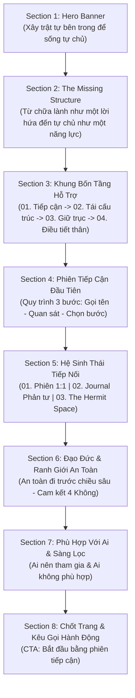

# KẾ HOẠCH HỢP NHẤT TRANG CHỦ & TRANG HỆ THỐNG
## INNER ARCHITECT™ — Unified Homepage & System Master Blueprint

> **Trạng thái tài liệu:** Đề xuất cấu trúc nội dung và phân bổ hình ảnh cho PM phê duyệt.  
> **Quy tắc tuân thủ:** Không can thiệp mã nguồn khi chưa có lệnh chính thức từ PM.

---

## 🎯 1. Mục tiêu và Lý do hợp nhất

| Trước khi gộp (2 trang riêng biệt) | Sau khi gộp làm một trang thống nhất |
| :--- | :--- |
| **Trang Chủ** tập trung giới thiệu cảm quan, lối vào dịch vụ và 3 pathway nhưng chưa nêu bật phương pháp luận sâu. | Khách vào website **thấy ngay triết lý cốt lõi, cơ chế 4 tầng can thiệp** và tính khoa học/an toàn của hệ thống. |
| **Trang Hệ Thống** chứa đầy đủ khung 4 tầng và đạo đức nhưng nằm ở trang phụ (`#/he-thong`), người dùng lướt nhanh dễ bỏ lỡ. | Giảm thiểu số lần nhấp chuột (click-depth), hành trình từ lúc tiếp cận đến hiểu và ra quyết định đặt lịch diễn ra liền mạch trên 1 trang dài (long-form editorial page). |
| Menu có cả "Trang chủ" lẫn "Hệ thống" gây phân tán nhận thức. | Thanh điều hướng gọn gàng: Trang chủ (bao gồm Hệ thống) · Journal · Chương trình · The Hermit · Đặt lịch. |

---

## 📐 2. Sơ đồ dòng chảy nội dung (Flow Architecture)

---

## 📑 3. Chi tiết 8 Phần Nội dung & Bố trí Hình ảnh

### Phần 1: Hero Banner & Định vị mở đầu
* **Mục đích:** Tạo ấn tượng tĩnh lặng, ấm áp, định vị rõ giải pháp tái cấu trúc nội tâm.
* **Tiêu đề lớn (H1):**
  > **Xây trật tự bên trong**  
  > *để sống tự chủ.*
* **Đoạn dẫn:**  
  *INNER ARCHITECT™ là một hệ thống tích hợp nhận thức, cảm xúc, cơ thể và đời sống thực — với phạm vi, ranh giới và điểm kết rõ ràng.*
* **Thanh định vị nhanh trong trang (In-page Anchor Nav):**  
  `Tổng quan` · `Bốn tầng` · `Quy trình gặp` · `Đạo đức` · `Đặt lịch`
* **Hình ảnh sử dụng:**  
  `TONG-HOP-HINH-ANH-THEO-TRANG/01-trang-chu/01-hero-ban-tarot-nen-am.jpg`  
  *(Tỉ lệ 16:9 hoặc 3:2, chụp bàn Tarot, khăn thổ cẩm, nến thơm và ánh sáng ấm).*
* **Nút hành động (CTA):** `Đặt lịch phiên tiếp cận` (`#/booking`) | `Tìm hiểu bốn tầng ↓`

---

### Phần 2: Khoảng trống cần giải quyết (*The Missing Structure*)
* **Mục đích:** Chỉ ra vấn đề của thị trường và lý do INNER ARCHITECT ra đời.
* **Eyebrow:** `THE MISSING STRUCTURE`
* **Trích dẫn nổi bật:**  
  > *“Con người không thiếu thêm lời khuyên. Điều thường thiếu là một cấu trúc đủ an toàn để tự nhìn rõ.”*
* **Tiêu đề phụ (H2):** *Từ chữa lành như một lời hứa đến tự chủ như một năng lực.*
* **Nội dung:**  
  INNER ARCHITECT™ được hình thành trước một thực tế dễ tạo ra sự phụ thuộc vào chuyên gia, biểu tượng hoặc những giải pháp chắp vá tức thì. Chúng tôi không đưa ra lời phán quyết hay quyết định thay bạn. Sứ mệnh của hệ thống là nối nhận thức, cảm xúc, cơ thể và hành động thành một tiến trình rõ ràng: có điểm vào, chuyển pha an toàn và có điểm kết thúc.
* **Hình ảnh bổ trợ:**  
  `TONG-HOP-HINH-ANH-THEO-TRANG/02-he-thong/01-khong-gian-lam-viec-founder-office.png`  
  *(Bàn làm việc mộc mạc, sách và góc tư duy của người xây dựng hệ thống).*

---

### Phần 3: Trục phương pháp luận — Khung Bốn Tầng Hỗ Trợ (*Four Layers*)
* **Mục đích:** Minh bạch hóa lộ trình làm việc, chứng minh tính có cấu trúc (Architectural).
* **Tiêu đề (H2):** *Bốn tầng tái cấu trúc nội tâm*
* **Nguyên tắc chuyển tầng:** *Chuyển tầng chỉ diễn ra khi nền tảng trước đó đủ ổn định.*
* **Bố cục trình bày 4 cột / 4 thẻ so le:**

| Tầng | Tên tầng | Nội dung thực hiện | Hình ảnh gán ghép phù hợp |
| :---: | :--- | :--- | :--- |
| **01** | **Tiếp cận ban đầu** | Tạo một ảnh chụp có giới hạn về trạng thái hiện tại, làm rõ nhu cầu và mức độ phù hợp trước khi đi sâu. | `01-trang-chu/02-loi-vao-phien-chuyen-sau-1-1.jpg` *(Góc đối thoại 1:1)* |
| **02** | **Chữa lành & Tái cấu trúc** | Nhận diện mô thức quen thuộc (patterns), kích hoạt nguồn lực bên trong và xây dựng lại cách phản hồi cảm xúc. | `03-journal/02-bai-2-khi-mo-thuc-cu-lap-lai-box-portrait.png` *(Hộp gỗ Huyền Giới Tarot)* |
| **03** | **Định hướng & Giữ trục** | Chuyển hiểu biết thành lựa chọn, thiết lập ranh giới cá nhân và nhịp sống có thể duy trì trong đời sống thật. | `05-khong-gian-the-hermit/03-goc-thuong-tra-cham-tea-room.png` *(Góc thưởng trà định tâm)* |
| **04** | **Điều tiết thân & Năng lượng** | Làm việc với cơ thể, nhịp thở và cảm giác thể chất để khôi phục khả năng tự điều hòa của hệ thần kinh. | `04-chuong-trinh-workshop/01-workshop-cham-ve-de-diu-lai.png` *(Chạm — Vẽ dịu lại)* |

---

### Phần 4: Lối vào thực tế — Phiên Tiếp Cận Đầu Tiên (*The First Meeting*)
* **Mục đích:** Hướng dẫn người đọc cách bắt đầu mà không bị choáng ngợp.
* **Tiêu đề (H2):** *Bắt đầu từ điều đang lặp lại: Nhìn rõ trước khi đi tiếp.*
* **Đoạn dẫn:**  
  Có thể bạn đã hiểu vấn đề bằng lý trí nhưng phản ứng cũ vẫn quay lại. Một phiên tiếp cận diễn ra với nhịp chậm và 3 bước rõ ràng:
  1. **Bước 1: Gọi tên** — Bạn mang đến điều đang chiếm nhiều năng lượng và sự băn khoăn nhất lúc này.
  2. **Bước 2: Quan sát** — Tarot và các câu hỏi phản tư giúp mở ra góc nhìn đa chiều, không áp đặt mệnh lệnh.
  3. **Bước 3: Chọn bước** — Cuộc gặp khép lại bằng một hành động nhỏ, vừa sức và thực tế cho đời sống thường nhật.
* **Hình ảnh sử dụng:**  
  `TONG-HOP-HINH-ANH-THEO-TRANG/01-trang-chu/02-loi-vao-phien-chuyen-sau-1-1.jpg`
* **Nút bấm:** `Xem thông tin & Đặt lịch phiên tiếp cận →` (`#/booking`)

---

### Phần 5: Tiếp tục khám phá theo nhịp riêng (*Pathways Mosaic*)
* **Mục đích:** Mở lối sang các nhánh chuyên sâu nếu người đọc chưa muốn đặt lịch ngay.
* **Tiêu đề (H2):** *Đi tiếp theo nhịp riêng.*
* **Thông điệp:** *Đây không phải các gói bắt buộc phải đi tuần tự. Bạn chỉ chọn điều phù hợp với trạng thái hiện tại.*
* **3 Thẻ Lộ Trình (Pathways Cards):**
  1. **01 — Phiên đầu tiên (1:1 Session):**  
     *Hình ảnh:* `01-trang-chu/03-the-lo-trinh-phien-dau-tien.png`  
     *Nội dung:* Cuộc gặp cá nhân riêng tư để định hình trạng thái.
  2. **02 — Thực hành phản tư (Journal & Self-work):**  
     *Hình ảnh:* `01-trang-chu/04-the-lo-trinh-thuc-hanh-phan-tu.png`  
     *Nội dung:* Đọc các bài viết chuyên khảo, ghi chép và tự soi chiếu.
  3. **03 — Không gian The Hermit (Tea & Slow space):**  
     *Hình ảnh:* `01-trang-chu/05-the-lo-trinh-the-hermit-room.png`  
     *Nội dung:* Một ấm trà, một cuốn sách và sự yên lặng có chủ đích.

---

### Phần 6: Đạo đức & Ranh giới an toàn (*Ethics & Boundaries*)
* **Mục đích:** Xây dựng sự an tâm và khẳng định tính liêm chính chuyên môn.
* **Eyebrow:** `ETHICS & BOUNDARIES`
* **Tiêu đề (H2):** *An toàn đi trước chiều sâu.*
* **Nội dung 4 Cam Kết Vàng:**
  * **Không hứa hẹn tuyệt đối:** Sự thay đổi là một tiến trình cá nhân đòi hỏi nỗ lực thực tế.
  * **Không tiên đoán tương lai:** Không dùng Tarot như công cụ bói toán hay gieo rắc sợ hãi.
  * **Không quyết định thay:** Mọi lá bài chỉ là bề mặt phản chiếu; quyền tự quyết luôn thuộc về bạn.
  * **Không gây phụ thuộc:** Mục tiêu là giúp bạn tự rời khỏi hệ thống để sống tự chủ.
* **Tuyên bố phi y tế bắt buộc:**  
  *Hệ thống không chẩn đoán và không thay thế hỗ trợ tâm lý, tâm thần hoặc y khoa. Khi nhận thấy tình trạng vượt ngoài phạm vi an toàn, người tham gia sẽ được hướng dẫn chuyển gửi sang các cơ sở chuyên môn y tế.*
* **Hình ảnh minh họa:**  
  `TONG-HOP-HINH-ANH-THEO-TRANG/03-journal/01-bai-1-tarot-khong-phai-tien-doan-reading-horizontal.png`

---

### Phần 7: Bộ lọc phù hợp (*Suitability*)
* **Mục đích:** Sàng lọc khách hàng đúng mục tiêu, từ chối các trường hợp sai kỳ vọng hoặc nguy cơ cao.
* **Tiêu đề (H2):** *Phù hợp khi bạn sẵn sàng tham gia chủ động.*
* **Bảng đối chiếu 2 cột:**

| Phù hợp với bạn nếu... | Không phù hợp nếu... |
| :--- | :--- |
| Bạn muốn nhìn lại các mô thức cũ và thử những thay đổi vừa sức. | Đang trong tình trạng khủng hoảng tâm lý cấp tính hoặc cấp cứu y khoa. |
| Bạn hiểu rằng phát triển bản thân là một tiến trình tự chịu trách nhiệm. | Bạn tìm kiếm một chẩn đoán bệnh lý tâm thần hoặc kê đơn điều trị. |
| Bạn muốn có một cấu trúc an toàn để tự đưa ra quyết định của chính mình. | Bạn mong muốn có ai đó quyết định thay, hoặc tìm kiếm giải pháp màu nhiệm tức thì. |

---

### Phần 8: Chốt trang & Kêu gọi hành động (*Closing & Action*)
* **Mục đích:** Tạo điểm dừng lắng đọng, thôi thúc bước hành động đầu tiên.
* **Tiêu đề (H2):** *Lắng lại một nhịp để bắt đầu.*
* **Thông điệp:** *Mục tiêu dài hạn không phải là ở lại mãi trong hệ thống, mà là phục hồi khả năng tự điều chỉnh và tự dẫn dắt cuộc đời của chính mình.*
* **Hình ảnh sử dụng:**  
  `TONG-HOP-HINH-ANH-THEO-TRANG/01-trang-chu/07-khong-gian-chiem-nghiem-cuoi-trang.jpg`  
  *(Ánh sáng tự nhiên, góc tĩnh lặng kết phiên).*
* **Nút bấm chính (Primary CTA):** `Bắt đầu bằng phiên tiếp cận` (`#/booking`)

---

## 🗃️ 4. Tóm tắt hình ảnh sử dụng cho trang Hợp nhất

| Thứ tự trên trang | Tên file trong `TONG-HOP-HINH-ANH-THEO-TRANG/` | Tỉ lệ khuyến nghị |
| :---: | :--- | :---: |
| **Hero 1** | `01-trang-chu/01-hero-ban-tarot-nen-am.jpg` | 16:9 ngang |
| **Section 2** | `02-he-thong/01-khong-gian-lam-viec-founder-office.png` | 4:5 đứng |
| **Section 3 (Tầng 1)** | `01-trang-chu/02-loi-vao-phien-chuyen-sau-1-1.jpg` | 4:3 |
| **Section 3 (Tầng 2)** | `03-journal/02-bai-2-khi-mo-thuc-cu-lap-lai-box-portrait.png` | 4:5 |
| **Section 3 (Tầng 3)** | `05-khong-gian-the-hermit/03-goc-thuong-tra-cham-tea-room.png` | 4:5 |
| **Section 3 (Tầng 4)** | `04-chuong-trinh-workshop/01-workshop-cham-ve-de-diu-lai.png` | 4:5 |
| **Section 4** | `01-trang-chu/02-loi-vao-phien-chuyen-sau-1-1.jpg` | 16:9 |
| **Section 5 (Card 1)**| `01-trang-chu/03-the-lo-trinh-phien-dau-tien.png` | 4:5 |
| **Section 5 (Card 2)**| `01-trang-chu/04-the-lo-trinh-thuc-hanh-phan-tu.png` | 4:5 |
| **Section 5 (Card 3)**| `01-trang-chu/05-the-lo-trinh-the-hermit-room.png` | 4:5 |
| **Section 6** | `03-journal/01-bai-1-tarot-khong-phai-tien-doan-reading-horizontal.png` | 16:9 |
| **Section 8** | `01-trang-chu/07-khong-gian-chiem-nghiem-cuoi-trang.jpg` | 16:9 |

---

## 🔒 5. Xác nhận quy tắc an toàn
* Không có bất kỳ file code nào trong `inner-architect-figma-make/src/` bị chỉnh sửa.
* Khi PM xem xét và phê duyệt cấu trúc bản thiết kế này, việc tích hợp code sẽ được tiến hành từng bước có kiểm soát.
