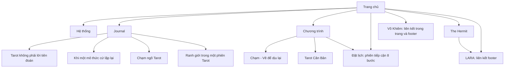
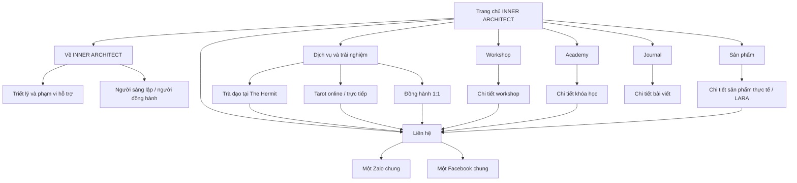

# Sitemap

## Cấu trúc quan sát được trong prototype

## Cấu trúc đề xuất cho MVP — chờ PM duyệt

Các cạnh về Liên hệ thể hiện hành trình; CTA trên trang chi tiết có thể mở thẳng Zalo/Facebook chung để giảm thao tác. Không bắt buộc đi qua trang Liên hệ.

## URL đề xuất

| Trang | URL |
| --- | --- |
| Trang chủ | / |
| Về thương hiệu | /ve-inner-architect |
| Hồ sơ người sáng lập | /ve-inner-architect/vo-khiem |
| Tổng quan dịch vụ | /dich-vu |
| Trà đạo / The Hermit | /dich-vu/tra-dao |
| Tarot | /dich-vu/tarot |
| Đồng hành 1:1 | /dich-vu/dong-hanh-1-1 |
| Workshop / chi tiết | /workshop, /workshop/[slug] |
| Academy / chi tiết | /academy, /academy/[slug] |
| Sản phẩm / chi tiết | /san-pham, /san-pham/[slug] |
| Journal / bài viết | /journal, /journal/[slug] |
| Liên hệ | /lien-he |
| Bảo mật / phạm vi hỗ trợ | /chinh-sach-bao-mat, /pham-vi-ho-tro |

Menu desktop gợi ý: Về chúng tôi · Dịch vụ · Workshop · Academy · Sản phẩm · Journal · Liên hệ. Dịch vụ mở ba nhánh. Mobile dùng cùng cấu trúc; CTA liên hệ luôn dễ tìm. Trang chính sách đặt ở footer.

URL chỉ là đề xuất. Cần kiểm kê URL website đang hoạt động trước khi lập bảng chuyển hướng cho việc thay website cũ; chưa giả định các đường dẫn hash của prototype là URL production.
