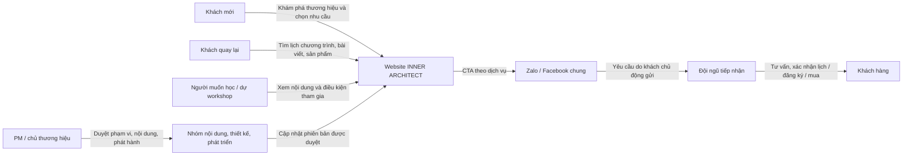
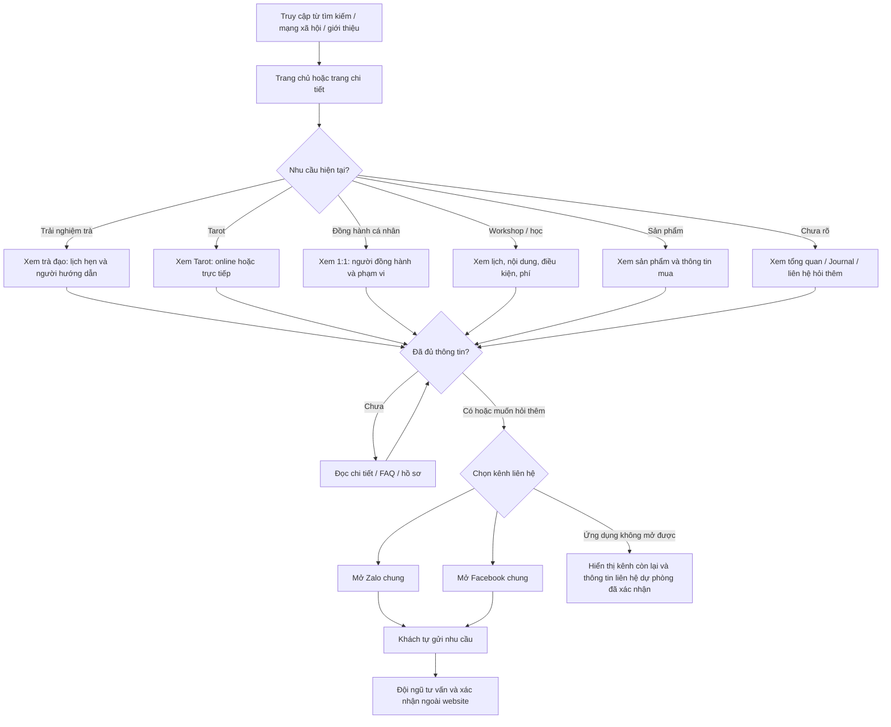

# Người dùng và website

Đây là mô hình hành vi để PM và nhóm thiết kế trao đổi; các nhóm người dùng là giả thuyết theo nhu cầu dịch vụ, chưa phải kết quả nghiên cứu người dùng.

## Sơ đồ các bên tham gia

Website hỗ trợ tìm hiểu và mở kênh liên hệ. Việc gửi tin, xác nhận lịch, thanh toán và theo dõi yêu cầu diễn ra ngoài website trong MVP. Chưa có trang quản trị hoặc CRM được quyết định.

## Hành trình chính

## Nhiệm vụ kiểm thử với người dùng

| Nhóm nhu cầu | Nhiệm vụ | Thành công khi |
| --- | --- | --- |
| Trà | Tìm cách đặt một buổi trà có hướng dẫn | Hiểu cần hẹn trước, biết nơi diễn ra và mở đúng kênh liên hệ |
| Tarot | Tìm phiên online | Phân biệt được online/trực tiếp, hiểu cách diễn ra và liên hệ đúng |
| Đồng hành | Tìm người hỗ trợ 1:1 | Đọc được hồ sơ/phạm vi và biết cách đề nghị trao đổi |
| Học tập | Đăng ký khóa Tarot hoặc workshop | Tìm đúng chương trình và CTA không đưa sang phiên tiếp cận không liên quan |
| Sản phẩm | Hỏi mua một sản phẩm | Tìm đủ thông tin sản phẩm và mở được kênh hỏi mua |
| Khách mới | Tìm hiểu INNER ARCHITECT có gì | Nhận ra sáu nhánh và quan hệ với cùng thương hiệu mẹ |

Ghi nhận đường đi thực tế, điểm ngập ngừng, nội dung khó hiểu và lỗi; không hướng dẫn trước rồi coi là người dùng tự hoàn thành.
